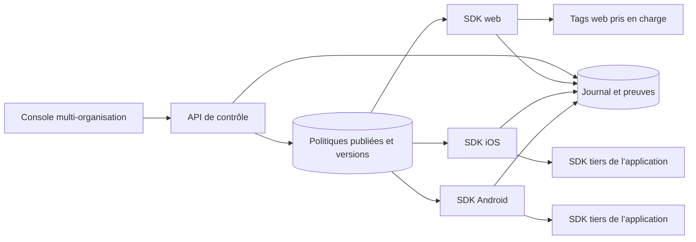

# Aman — architecture de produit cible

## Objectif

Aman est un service B2B multi-organisation qui permet à une entreprise de définir une politique de consentement versionnée, de la publier vers ses sites web et ses applications mobiles, et de faire respecter les choix par les intégrations qu’elle configure.

Il s’agit d’un outil de configuration et d’exécution. Le responsable de traitement décide des finalités et de la règle applicable avec ses équipes compétentes. Aman ne détermine pas automatiquement la légalité d’un traitement et ne promet pas une conformité garantie.

## Vue d’ensemble

## Séparer les plans

### Plan de contrôle

- Organisations et propriétés (`web`, `ios`, `android`) avec rôles et environnements distincts.
- Politiques en brouillon ; revue et publication explicite par version.
- Répertoire des finalités, fournisseurs, notice, langues, règles d’application et durées configurés par le client.
- Journal d’administration : acteur, version, date, modification, publication.
- Gestion des utilisateurs d’entreprise, MFA / SSO et permissions fines dans les étapes prévues pour la cible banque.

### Plan de diffusion

- Endpoint de lecture en cache pour récupérer la dernière politique publiée d’une propriété, avec version et cache validator.
- SDK web qui charge la configuration puis contrôle uniquement les scripts déclarés avec une catégorie prise en charge.
- SDK natifs iOS et Android qui affichent le parcours de choix, conservent la préférence localement, recalculent et signalent son expiration pour réconcilier les SDK tiers, puis exposent toute modification de règle à l’application hôte.
- Chaque SDK doit fonctionner avec une politique déjà reçue si le terminal est temporairement hors ligne. Une préférence expirée ou une politique inconnue suit une règle fermée définie par le contrôleur.
- Les SDK ne peuvent pas arrêter universellement un SDK publicitaire déjà initialisé ; les partenaires doivent connecter chaque finalité à l’état Aman et désinitialiser / désactiver les fonctions concernées quand c’est possible.

### Preuves minimales et données

- L’état de préférence contient `propertyId`, `policyVersion`, canal, choix par finalité, instant de décision et expiration.
- Le mode par défaut ne collecte aucun nom, courriel, identifiant client bancaire, IDFA/AAID, empreinte d’appareil, IP conservée en journal applicatif ou événement de navigation détaillé.
- Un reçu distant exploitable par le client demande une décision explicite de modèle de preuve et de minimisation : rattacher un reçu à une personne peut le rendre personnel. Prévoir une option locale et un export côté administrateur comme cas minimaux.
- Définir la conservation et la suppression par type de donnée, finalité, canal, contrat et texte applicable. La règle de six mois de la décision cookies ne doit pas être étendue automatiquement aux autres traitements mobiles.
- Cartographier les transferts, sous-traitants et hébergement avant de choisir le fournisseur cloud ou la région. Ne publier aucune promesse de résidence ou de transfert autorisé avant revue CNDP et juridique.

## Contrat de politique

Le premier contrat versionné se trouve dans [schemas/consent-policy.schema.json](./schemas/consent-policy.schema.json). Les règles `required` et `consentRequired` sont explicites : chaque finalité porte son propre classement, sa disponibilité par canal et ses libellés FR / AR. La notice visiteur peut fournir un bloc `noticeTranslations` français et arabe ; les SDK choisissent le bloc correspondant à la langue affichée et retombent sur `notice` pour les anciennes politiques. Les SDK natifs rejettent aussi les versions de schéma inconnues, les langues et canaux non pris en charge, les finalités mal formées ou contradictoires et les durées hors limites. Une valeur de configuration manquante ou inconnue échoue fermée pour les tags optionnels.

Les politiques web et mobiles utilisent le même vocabulaire de finalités et la même version. Le rendu, les API du terminal et les contrôles des fournisseurs restent adaptés au canal. Les applications natives peuvent exiger des prompts de plateforme séparés.

L’API rejette avant parsing JSON les corps de requête supérieurs à 1 Mio par défaut, 512 Kio pour les brouillons de politique et 16 Kio pour les événements de consentement. Le schéma limite une politique à 64 finalités, 32 fournisseurs par finalité et 32 éléments par liste de notice ; les intégrateurs doivent garder leurs configurations sous ces plafonds.

## Déploiement par étapes

Le plan d’ingénierie pour sortir du stockage SQLite local, versionner le schéma et ouvrir un pilote hébergé se trouve dans [PLAN_MIGRATION_PRODUCTION.md](./PLAN_MIGRATION_PRODUCTION.md). Il ne choisit ni fournisseur cloud ni région sans exigences client documentées, et ne lève pas le verrou qui interdit actuellement le mode production.

1. **Tranche locale actuelle :** tableau de bord avec comptes réels des organisations, propriétés étiquetées par environnement (développement, recette, production), origines Web configurées, versions publiées, brouillons et actions administratives pour la session connectée ; console locale, politiques versionnées, publication à deux personnes, audit et export CSV. Le SDK Web peut transmettre sur activation explicite des décisions client déclarées et le tableau de bord en affiche des comptes agrégés. Les routes publiques Web vérifient l’`Origin` contre l’origine exacte de la propriété, sans cookies ; les SDK natifs exposent un appel facultatif sans identifiant durable, que l’application hôte doit invoquer explicitement. Les statistiques de scan intégrées restent simulées ; un outil séparé permet un inventaire ponctuel dans l’onglet courant, avec classement manuel et export JSON local, puis l’import explicite d’un rapport dans une propriété Web dont l’origine correspond. L’API conserve au plus 20 rapports par propriété, avec suppression manuelle, dans SQLite local. Ces événements ne prouvent ni identité ni affichage/action réelle et l’API utilise SQLite local : cette tranche sert à démontrer les parcours et recueillir des exigences, pas à traiter des données de clients.
2. **Pilote web acheteur :** reste à faire après accord juridique, sécurité et achats. Il faudra choisir l’hébergement et l’isolation, remplacer le stockage local par une base opérée, intégrer les contrôles d’accès attendus et limiter le périmètre à un domaine public non authentifié selon les conditions du client.
3. **SDK mobiles :** les sources iOS et Android lisent et mettent en cache une politique publique, affichent un parcours natif FR/AR et exposent un état hors ligne à l’application hôte. Les états effectifs sont aussi notifiés à l’expiration d’un choix et peuvent être rafraîchis au retour au premier plan. Il reste à compiler, packager, intégrer et vérifier ces cycles dans les environnements natifs avant une POC mobile acheteur.
4. **Prêt banque :** SSO, MFA, rôles renforcés, audit exportable, disponibilité, sauvegarde/restauration, réponse aux incidents, pentest indépendant, SLA, hébergement/transferts acceptés, contrats, support et dossier sécurité fournisseur.

Ne pas accélérer vers une POC avec données personnelles ou applications de production avant le passage juridique, sécurité et achats documenté dans [PLAN_COMMERCIALISATION.md](./PLAN_COMMERCIALISATION.md).

## Intégration native et limites des plateformes

- **iOS :** le choix Aman peut gouverner les préférences de finalité de l’application, mais ne remplace pas le prompt App Tracking Transparency lorsque les usages relèvent de la définition Apple du tracking. Le SDK livré avec l’application doit fournir une déclaration précise de ses propres usages dans `PrivacyInfo.xcprivacy`.
- **Android :** le SDK doit exposer clairement ses pratiques, permissions et signaux de consentement à l’application hôte. Les responsabilités de divulgation des bibliothèques / SDK tiers incombent aussi à l’éditeur d’application ; l’état Aman ne remplace pas la fiche Data safety Google Play.
- **WebView :** distinguer les contenus contrôlés par l’app et les pages web ; éviter un second bandeau concurrent et prévoir une synchronisation explicite des préférences seulement si elle est validée par le client.

## Décisions techniques à obtenir pendant la découverte entreprise

- SaaS mutualisé, tenant isolé, cloud privé ou installation dédiée ?
- Où les données sont-elles hébergées et quelles connexions sortantes doivent être autorisées ?
- Le client attend-il un reçu centralisé, une preuve locale, ou les deux ?
- Quelles applications SDK natives, frameworks analytics / marketing et WebViews sont réellement utilisées ?
- Qui peut publier une politique, sur quels environnements, avec quel double contrôle ?
- Durée d’assistance, journalisation, région de reprise et conditions de sortie / suppression ?

## Références principales

- [CNDP — Délibération D-939-2025 relative aux cookies (PDF)](https://www.cndp.ma/wp-content/uploads/2025/12/Deliberation-N%C2%B0-D-939-2025-du-28112025-relative-au-modele-de-declaration-simplifiee-relative-au-traitement-des-donnees-a-caractere-personnel-de-cookies-sur-un-terminal.pdf)
- [CNDP — Loi 09-08](https://www.cndp.ma/images/lois/Loi-09-08-Fr.pdf)
- [Apple — Privacy manifest files](https://developer.apple.com/documentation/BundleResources/privacy-manifest-files)
- [Apple — User Privacy and Data Use / ATT](https://developer.apple.com/app-store/user-privacy-and-data-use/)
- [Android Developers — SDK best practices](https://developer.android.com/guide/practices/sdk-best-practices)
- [Google Play — Data safety disclosures](https://developer.android.com/about/versions/14/features/app-metadata)
